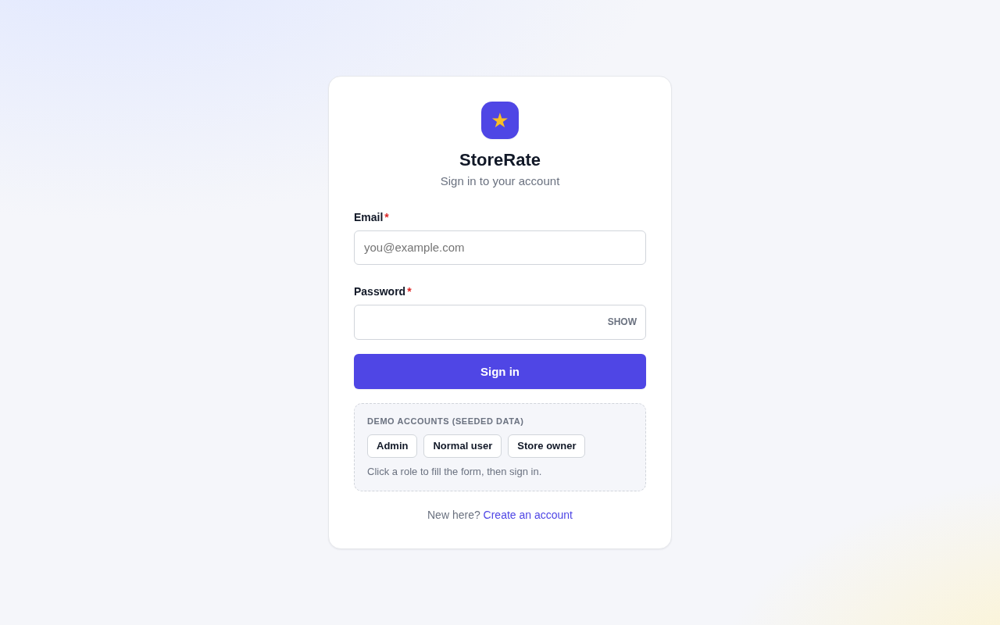
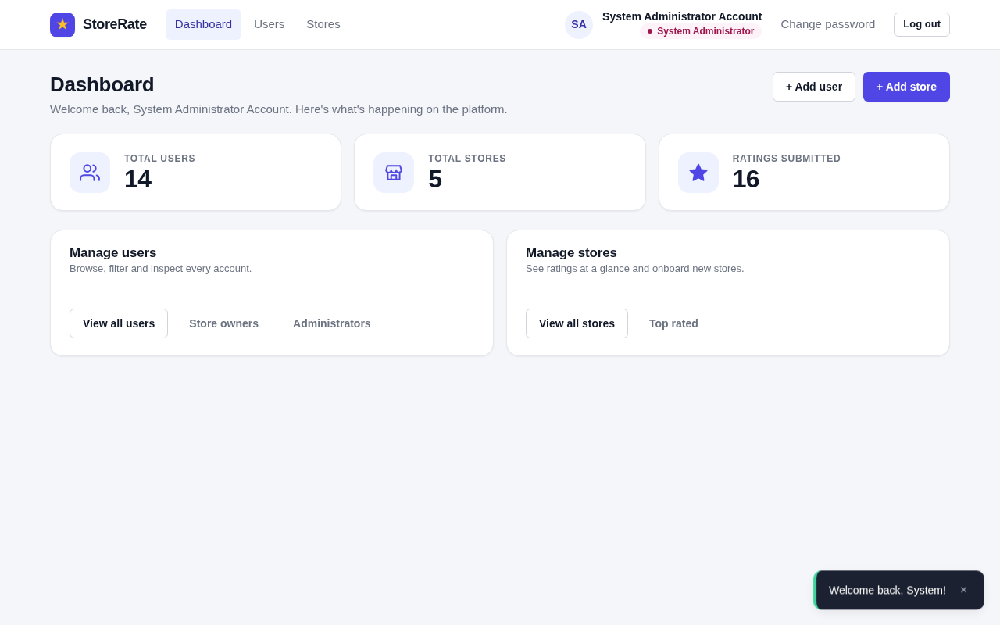
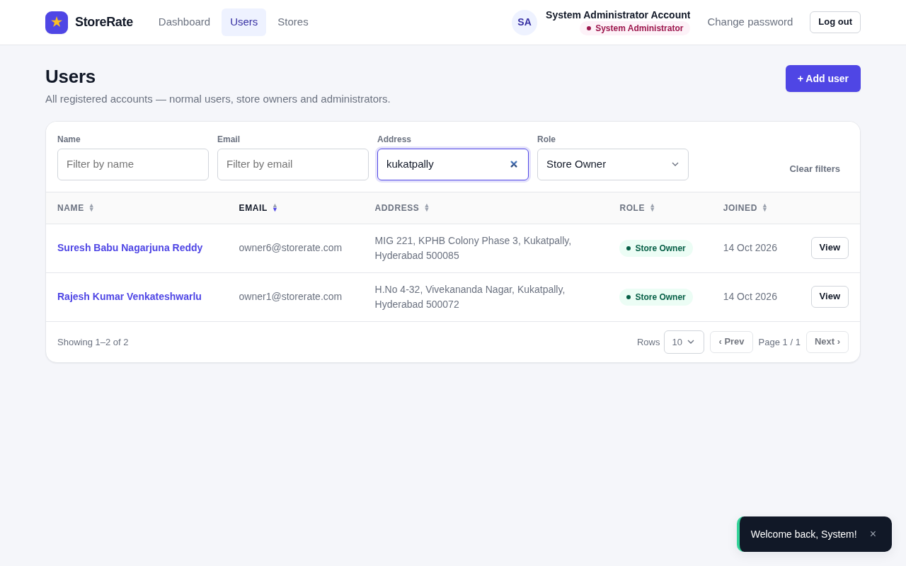
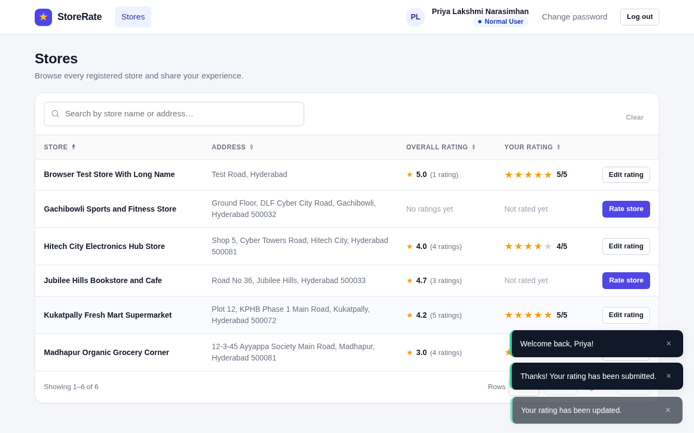
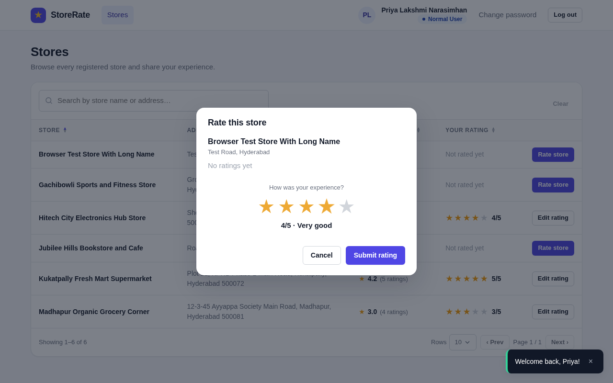
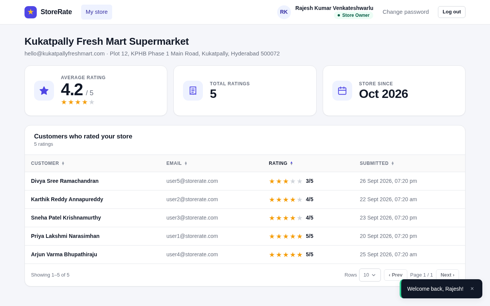

# ⭐ StoreRate

A full-stack web application where users rate stores registered on the platform (1–5 stars), built for the
**FullStack Intern Coding Challenge (V1.1)**.

| Layer | Stack |
|---|---|
| Backend | Node.js 20 · **Express 5** · **Knex.js** · zod · JWT (jsonwebtoken) · bcryptjs · helmet · express-rate-limit |
| Database | **PostgreSQL 17** (migrations + seeds via Knex) |
| Frontend | **React 19** · Vite · react-router v7 · axios · hand-written CSS (no UI framework) |
| Tests | `node:test` + supertest (backend integration), vitest (frontend validators) |

One login for everyone; what you see after signing in depends on your role:

| Role | What they can do |
|---|---|
| **System Administrator** | Dashboard (total users / stores / ratings) · add users of any role · add stores (assign an existing owner or create one inline) · list, filter & sort users and stores · view user details (store owners show their store's rating) |
| **Normal User** | Sign up · browse & search stores by name/address · see overall rating and their own rating · submit **and modify** a rating · change password |
| **Store Owner** | Dashboard with the store's average rating and the list of users who rated it · change password |

## Screenshots

| Login | Admin dashboard | Users (filter + sort) |
|---|---|---|
|  |  |  |

| Normal user – stores | Rate a store | Store owner dashboard |
|---|---|---|
|  |  |  |

---

## 1. Quick start

### Prerequisites
- Node.js ≥ 20 and npm
- PostgreSQL ≥ 14 (or Docker, see below)

### 1.1 Database
Either use Docker:
```bash
docker compose up -d          # Postgres 17 on localhost:5432 with user/password/db = storerate
```
…or create the role and databases on an existing PostgreSQL:
```sql
CREATE ROLE storerate LOGIN PASSWORD 'storerate' CREATEDB;
CREATE DATABASE storerate      OWNER storerate;
CREATE DATABASE storerate_test OWNER storerate;   -- used by `npm test`
```

### 1.2 Configure & run
```bash
npm run setup     # installs root + backend + frontend deps, creates backend/.env from .env.example, migrates & seeds the DB
npm run dev       # API on :4000, web app on :5173 (proxies /api to the API)
```
`backend/.env` is only created if it doesn't exist — edit `DATABASE_URL` / `JWT_SECRET` there if your setup differs.
Open **http://localhost:5173** and sign in with a demo account.

### 1.3 Demo accounts (created by the seed)
| Role | Email | Password |
|---|---|---|
| System Administrator | `admin@storerate.com` | `Admin@1234` |
| Normal User | `user1@storerate.com` … `user6@storerate.com` | `User@12345` |
| Store Owner | `owner1@storerate.com` … `owner5@storerate.com` (each owns a store) | `Owner@1234` |
| Store Owner (no store yet) | `owner6@storerate.com` | `Owner@1234` |

The login page shows one-click buttons for these accounts (hide them with `VITE_SHOW_DEMO_CREDENTIALS=false`).

### 1.4 Useful scripts
| Where | Command | What |
|---|---|---|
| root | `npm run dev` | backend + frontend concurrently |
| root | `npm test` | backend integration tests + frontend unit tests |
| root | `npm run lint` | ESLint on both projects |
| root | `npm run format` / `format:check` | Prettier (shared `.prettierrc`) on both projects |
| backend | `npm run db:migrate` / `db:rollback` / `db:seed` / `db:reset` | schema & demo data |
| backend | `npm test` | runs against `TEST_DATABASE_URL` (never touches dev data) |
| frontend | `npm run build` / `npm run preview` | production bundle |

---

## 2. Project structure

```
storerate/
├── backend/
│   ├── knexfile.js                 # CLI config (migrations / seeds)
│   ├── src/
│   │   ├── app.js                  # Express app: helmet → cors → json → routes → 404 → error handler
│   │   ├── server.js               # boot + graceful shutdown
│   │   ├── config/     env.js (validated env) · db.js (knex + snake/camel mapping)
│   │   ├── db/         migrations/ · seeds/
│   │   ├── middleware/ authenticate · authorize · validate · rateLimit · errorHandler
│   │   ├── modules/    auth/ · admin/ · stores/ · owner/ · users/   (routes → controller → service → repository)
│   │   ├── utils/      ApiError · listQuery (filters, sorting, pagination) · jwt · password · caseMapping
│   │   └── validation/ rules.js    # single source of truth for field rules (zod)
│   └── tests/                      # node:test + supertest integration suites
├── docs/                           # PLAN.md (approved design), api.http, screenshots/
├── .github/workflows/ci.yml        # lint + tests (real PostgreSQL service) + build on every push / PR
└── frontend/
    └── src/
        ├── api/        axios client (auth header, 401 handling, error normalisation) + per-module APIs
        ├── context/    AuthContext · ToastContext
        ├── hooks/      useListQuery (URL-synced sort/filter/pagination) · useAsync
        ├── components/ ui (incl. ErrorBoundary) · forms · table (DataTable, FilterBar) · rating · layout · routing guards
        ├── pages/      auth · account · admin · user · owner
        ├── utils/      validators.js (mirrors backend rules) · roles · format · session
        └── styles/     global.css (design tokens + components)
```

---

## 3. Database schema

```
users (id, name, email, password_hash, address, role[admin|user|store_owner], created_at, updated_at)
  └─< stores (id, name, email, address, owner_id → users.id  UNIQUE, created_at, updated_at)
        └─< ratings (id, user_id → users.id, store_id → stores.id, rating 1..5, created_at, updated_at)
                     UNIQUE (user_id, store_id)
```

Design decisions:
- **Validation rules are enforced twice**: zod on the API, and `CHECK` constraints in PostgreSQL
  (`char_length(name) BETWEEN 20 AND 60`, `char_length(address) <= 400`, `rating BETWEEN 1 AND 5`).
- **Case-insensitive unique emails** via expression indexes on `lower(email)`; emails are lower-cased on write.
- **One store per owner** (`stores.owner_id UNIQUE NOT NULL`); the service layer also checks the owner's role.
- **One rating per user per store** (`UNIQUE(user_id, store_id)`): "modify rating" is an `INSERT … ON CONFLICT DO UPDATE`.
- **Averages are never stored** — always `ROUND(AVG(rating), 1)` + `COUNT(*)` at query time, so they can't drift.
- `updated_at` is maintained by a trigger; `ON DELETE CASCADE` for ratings, `RESTRICT` for store owners.

---

## 4. REST API

Base URL `/api`. Send the token on protected routes as `Authorization: Bearer <token>` **or** `X-Auth-Token: <token>`
(the web client sends both: some reverse proxies / preview tunnels strip the `Authorization` header).
Lists accept `?sortBy=&order=asc|desc&page=&limit=` (whitelisted sort fields; `limit` ≤ 100) plus the filters below
and return `{ data: [...], meta: { page, limit, total, totalPages } }`.

| Method | Endpoint | Role | Description |
|---|---|---|---|
| `POST` | `/auth/register` | public | Sign up as a normal user → `201 { token, user }` |
| `POST` | `/auth/login` | public | → `{ token, user }` |
| `GET` | `/auth/me` | any | Current profile (+ `store` summary for owners) |
| `PATCH` | `/auth/password` | any | `{ currentPassword, newPassword }` |
| `GET` | `/admin/dashboard` | admin | `{ totalUsers, totalStores, totalRatings }` |
| `GET` | `/admin/users` | admin | Filters `name,email,address,role`, `unassignedOwners=true`; sort `name,email,address,role,createdAt` |
| `POST` | `/admin/users` | admin | `{ name, email, password, address, role }` |
| `GET` | `/admin/users/:id` | admin | `{ user, store }` — store (with `averageRating`, `ratingCount`) for store owners |
| `GET` | `/admin/stores` | admin | Filters `name,email,address`; sort `name,email,address,rating,createdAt`; includes `owner` |
| `POST` | `/admin/stores` | admin | `{ name, email, address, ownerId }` **or** `{ …, owner: { name, email, password, address } }` (transactional) |
| `GET` | `/stores` | user | Filters `q` (name **or** address), `name`, `address`; sort `name,address,rating,myRating`; includes `myRating` |
| `PUT` | `/stores/:storeId/rating` | user | `{ rating: 1..5 }` — upsert: `201` on first submission, `200` on modification |
| `GET` | `/owner/dashboard` | store_owner | `{ store }` with `averageRating` and `ratingCount` (`null` if no store assigned) |
| `GET` | `/owner/ratings` | store_owner | Users who rated the store; sort `name,email,rating,createdAt` |
| `GET` | `/health` | public | Liveness + DB check |

Errors always look like:
```json
{ "error": { "code": "VALIDATION_ERROR", "message": "Validation failed",
             "details": [ { "field": "name", "message": "Name must be between 20 and 60 characters" } ] } }
```
Codes: `VALIDATION_ERROR` 400 · `UNAUTHORIZED` 401 · `FORBIDDEN` 403 · `NOT_FOUND` 404 · `CONFLICT` 409 · `RATE_LIMITED` 429 · `INTERNAL_ERROR` 500.
A ready-to-use request collection lives in [`docs/api.http`](docs/api.http) (VS Code REST Client / JetBrains HTTP client).

---

## 5. Validation rules (frontend **and** backend)

| Field | Rule |
|---|---|
| Name (users and stores) | 20–60 characters |
| Email | standard email format, unique (case-insensitive) |
| Address | required, max 400 characters |
| Password | 8–16 characters, at least one uppercase letter and one special character |
| Rating | integer 1–5 |

---

## 6. Security & best practices

- Passwords hashed with bcrypt; hashes never leave the service layer.
- Stateless JWT (24 h) verified on every request; the user is re-loaded from the DB so role changes apply immediately.
  Accepted via `Authorization: Bearer` or `X-Auth-Token` so proxies that sanitise `Authorization` can't break sign-in.
- Role checks happen **on the server** (`authorize()`); client-side guards only improve UX.
- All input validated with zod before touching the DB; PostgreSQL constraints as the second line of defence.
- Parameterised queries only, whitelisted `ORDER BY` fields, escaped `LIKE` wildcards.
- `helmet`, restricted CORS, 10 kB JSON body limit, rate limiting on login/register.
- Consistent error envelope, no stack traces in production, central error handler, graceful shutdown.
- Multi-step writes (owner + store) run in a transaction.
- Frontend: axios interceptors (auth header, automatic logout on 401 with a "session ended" notice), table state in the
  URL, debounced filters, accessible forms (labels, `aria-invalid`, `aria-describedby`), keyboard-friendly star rating
  (radio group), an error boundary so a render error never leaves a blank screen.

---

## 7. Testing

```bash
cd backend && npm test        # 32 tests: validation rules, auth (incl. token transports), admin, stores/ratings/owner (real PostgreSQL)
cd frontend && npm test       # validator unit tests
```
Backend tests run against `TEST_DATABASE_URL`, rebuild the schema with the real migrations, and truncate between tests.
The same suites (plus ESLint, Prettier and the production build) run in GitHub Actions — see `.github/workflows/ci.yml`.

---

## 8. Assumptions (where the brief was silent)

1. Store names follow the same 20–60 character rule as user names (the brief lists the Name rule globally). It's a
   single constant (`LIMITS.NAME_MIN`) if that should be relaxed for stores.
2. Each store owner owns exactly one store; owners are created via *Add user → Store Owner* or inline from *Add store*.
3. Only normal users rate stores; one rating per user per store, modifiable at any time.
4. Changing a password requires the current password and is available to every role.
5. Admin's **Users** list shows all roles with a role filter, which covers "normal and admin users" and lets admins open
   store owners to see their rating.
6. Overall rating = average rounded to one decimal, shown with the number of ratings; "No ratings yet" when empty.
